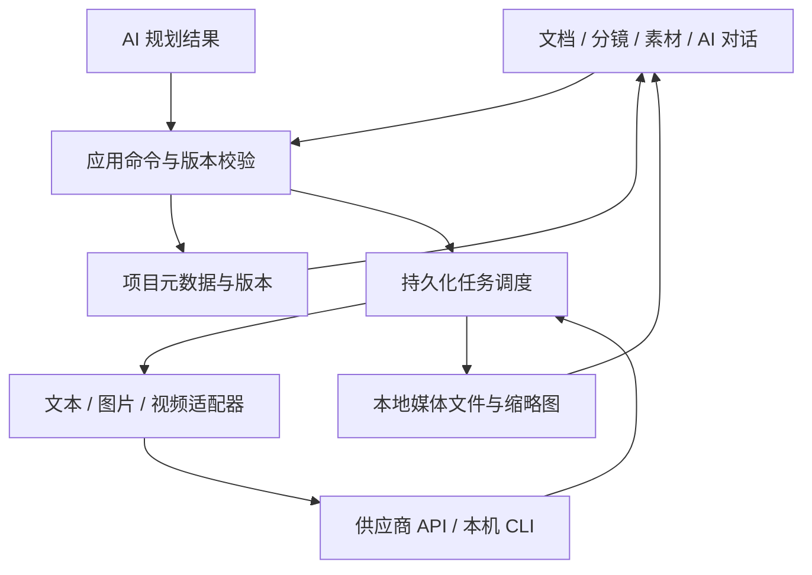

# 个人 AI 创作工作台整体方案

日期：2026-10-10

状态：产品与落地方案已整理，P0 文字与 P1 分镜／图片核心主路径已于 2026-10-12 在 macOS 隔离桌面环境验收；P2 按用户选择先完成通用接入框架，不包含真实视频生成验收或正式发布。实施契约、逐项证据和未覆盖项见[多模态实现契约](./多模态实现契约.md)。适用于现有项目 `ai-creator-workbench`，沿用 macOS Apple Silicon、本地优先、无初始示例数据的定位，保留后续 Windows 扩展。

## 方案摘要

| 决策 | 本方案结论 |
| --- | --- |
| 产品定位 | 在现有桌面项目内升级个人创作工作台，利用已有资源，不做商业平台或另一个一键视频工具 |
| 内容范围 | 灵感、文字、故事和剧本可以独立完成；分镜、图片和视频是按需要延伸的路径 |
| 主交互 | 对话辅助，文档／分镜／素材承载可直接编辑的结果；可跳过、回退或局部重做 |
| 执行端 | 能力与调用方式分开，每步选择实际支持的 API／CLI／本地服务；Codex CLI 图片纳入首批适配目标，当前账号与受控调用是否可用须真实验收 |
| 知识库 | 用户选择 Obsidian Vault／本地目录，只读引用；关键词检索保底，向量索引可选，不依赖插件私有数据库 |
| 默认视频路径 | 确认角色／场景参考 → 拆镜与状态校对 → 分镜图审核 → 图生视频 → 审阅与局部重做 |
| 一致性 | 绑定并传递确切参考版本，记录镜头起止状态，区分连续动作与切换机位；不承诺模型绝对一致 |
| 可靠性 | 真实任务、真实文件、候选版本和完整备份；不静默换执行端或重复计费生成 |
| 技术与顺序 | 复用 Tauri／Rust／SQLite，先整合资源与文字流程，再接通分镜、Codex 图片及已有视频资源；粗剪按需 |
| 首版边界 | 文字、图片可以分阶段独立交付；多模态首版完成须包含一种实际视频资源的镜头制作闭环，不把未接通能力当作完成 |

本文件作为产品方案的唯一汇总入口，确定目标流程、实现边界与分期验收；[技术方案](./技术方案.md)归纳实现决策与交付门槛，[多模态实现契约](./多模态实现契约.md)单独维护实施接口、检查证据和剩余工作。方案中的目标能力不等于当前软件已完成或可用。

### 推荐落地方式

先在连接中心登记已有资源，再创建空白项目；用“文档 → 镜头 → 素材版本”保存每一步成果，用右侧助手讨论、修改或提交明确范围的生成。用户可以停在剧本，也可以直接从已有图片进入制作，不必从头跑流程。

首版重点不是增加供应商数量，而是让一种文字资源、一种图片资源及一种实际已有视频资源分别完成真实闭环。视频默认先审分镜图再生成短片段，最终素材可以交给现有剪辑软件；应用内时间线不作为前置条件。

保留三个独立边界：连接中心管理调用方式，项目步骤选择执行端，任务中心记录实际执行。全局默认只供未单独配置的项目继承；切换全局资源不改写项目选择，资源失效不自动替换。

## 1. 产品定位与成功标准

供个人使用的 AI 创作工作台，统一利用用户已有的 API、CLI、本地模型与知识资料，支持灵感、文字内容、故事、短剧和漫剧创作。用项目组织创作，用文档、素材和可选分镜承载结果，用 AI 对话辅助创作与执行可追踪的操作。

不以超越 Flova、做商业平台或一键视频工具为目标；不要求购买新的供应商服务。不为竞争差异增加复杂功能，也不把会员、多人协作、社区、模型市场和自动化大批量生产列入首版。

用户既可以只写文本，也可以从已有剧本、角色图或场景图开始制作。创作路径是可选的，不强迫所有项目依次经过固定向导。

核心成功标准：用户能用自己的实际资源完成一次创作，每一步知道使用哪个执行端、读取哪些资料、产生什么结果；结果可编辑、复用与导出。只有文本资源时，文字创作即可形成完整闭环；具备图片／视频资源时，再扩展到对应制作环节。

## 2. 总体流程与参考原则

主流程：灵感／资料 → 创作简报 → 设定／大纲／正文或剧本 → 可选分镜 → 图片 → 可选视频 → 素材导出／后续粗剪。

| 流程预设 | 使用目标 | 可独立结束的位置 |
| --- | --- | --- |
| 文字创作 | 想法、结构、正文、修改 | 可编辑并导出的文字内容 |
| 剧本创作 | 人物／世界设定、大纲、分集／分场、剧本 | 可编辑并导出的剧本 |
| 分镜制作 | 从已有剧本或素材拆镜，准备画面，再制作视频 | 分镜清单、图片或镜头视频 |

默认剧情视频路径为“角色／场景参考 → 分镜图 → 画面审核 → 图生视频 → 检查与局部重做”；文字创作不依赖这条路径。分镜图可以由 Codex CLI、图片 API 生成，也可以导入。所有步骤都复用同一个项目的对象与版本。

- 以“对话辅助、结构化工作区、直接编辑结果”作为统一交互主线，参考 Flova 的文档、分镜和资产关联，不完整复刻其产品。
- 图片／视频环节参考 Google Flow 的参考素材与镜头迭代方式；首尾帧等操作仅在已有执行端支持时开放。
- 两者能力有重叠，不按产品机械划分模块；以本工作台的创作对象和用户任务决定交互。
- 流程与供应商解耦。同一流程可以换用已有 API、CLI 或本地模型；只向执行端传递其支持的输入。
- 使用用户获准调用的 API 和本机 CLI，不把其他产品网页的生成能力或网页订阅视为已获得的接口授权。

## 3. 信息架构与界面

全局保留“项目、灵感库、知识库、连接中心、设置”。进入项目后，主要视图为：

| 视图 | 主要用途 | 结果 |
| --- | --- | --- |
| 创作 | 灵感、简报、设定、人物、分集和分场剧本 | 文本文档与版本 |
| 分镜 | 拆镜、排序、镜头编辑、生成图片与视频 | 分镜卡片及选用素材 |
| 素材 | 管理角色、场景、道具、风格及独立媒体 | 可复用资产与候选版本 |
| 成片 | 后续提供镜头排序、裁剪、音轨、字幕及导出 | 粗剪序列与成片 |

布局：左侧项目导航，中间当前视图，右侧可收起 AI 助手；任务中心以抽屉打开。成片视图再展示时间线，不长期挤占写作空间。

首版分镜使用有序卡片列表／网格，支持拖动和上移下移按钮。每张卡片可打开镜头详情，查看输入、引用素材、生成结果和版本。自由无限画布作为后续可选视图。

首版不展示无法操作的成片时间线或假生成入口。尚未接入的能力说明原因并提供导入／连接资源入口；成片视图在粗剪能力完成后启用。

沿用现有暖白、墨色、琥珀选中态和深色主题。文档维持阅读密度，分镜增加媒体预览密度；无内容时展示真实创建入口，不填充示例项目或虚假任务。

### 3.1 从资源到创作的主路径

1. 连接中心：查看已有连接，新增或检测 API／CLI，展示实际可用能力及不可用原因。检测不默认触发计费生成；需要真实生成验证时由用户明确发起。
2. 创建／打开项目：可从空白、已有正文或导入素材开始，选择“文字创作”“剧本创作”或“分镜制作”流程预设；预设只提供步骤和空白结构，不生成示例数据。
3. 选择当前步骤：看到输入、可选知识资料、执行端、模型（执行端允许选择时）和输出位置。默认复用上次配置，可按项目／步骤覆盖。
4. 创作与审阅：执行后结果进入当前文档或候选区，用户直接编辑、采纳或只重做选定部分，再决定是否进入下一步。
5. 保存与导出：正文和选用结果自动保存；文字导出不依赖媒体能力，媒体导出仅包含真实已有文件。

流程预设见第 2 节。步骤可跳过或回退，不强制线性执行。回退保留已填内容和历史产物；重做上游只标记下游输入可能过期，不清空结果。

首版采用固定步骤加每步执行端配置，不做通用节点编排器或自由拖线工作流。每步保存输入对象、知识引用、执行端、参数、输出类型及是否需要采纳。

### 3.2 分支、状态与恢复

| 状态／分支 | 用户看到与可执行操作 |
| --- | --- |
| 首次无资源 | 显示新增 API、检测 CLI 和手动创作入口；不默认选用不存在的服务 |
| 资源检测／知识检索中 | 显示当前阶段；不将尚未返回的能力标为可用；防止同一检测重复提交 |
| 资源可用 | 展示能力、执行端和适用步骤；切换执行端保留内容，不自动提交生成 |
| 凭据缺失／CLI 未授权 | 区分已安装、可运行和可执行创作，提供对应配置入口，不以“已安装”代替“可调用” |
| 只有文本能力 | 可完成全部文字步骤；图片／视频步骤说明缺少资源，允许导入素材、跳过或连接资源 |
| 空文档／空素材 | 展示新建、导入或生成入口，无初始示例内容 |
| 正在执行 | 展示任务状态并防重复提交；可查看输入快照、取消等待或停止后续步骤 |
| 执行失败 | 保留正文、草稿和输入；展示原因与针对性的重试／配置入口，不自动切换执行端 |
| 来源更新／修改冲突 | 显示受影响对象或双方版本，允许比较和选择，不覆盖用户新编辑 |

连接字段采用字段级错误提示，提交前校验地址、必填认证信息和协议配置；校验失败保留输入，成功后回到连接详情并显示真实检测状态。密钥不回显到日志或创作上下文。普通发送与直接编辑不增加确认弹窗；删除被引用素材、不可恢复操作和 Agent 扩大的批量执行范围需要说明影响后确认。

## 4. 创作对象与关联

### 4.1 项目、剧本与镜头

项目保存内容类型、目标比例、目标时长及风格简报；分集、分场和镜头有稳定标识。镜头关联来源剧本段落、人物和场景，并保存画面描述、对白、景别、运镜、目标时长、参考图与选用图片／视频版本。

剧本是叙事依据，分镜是镜头结构依据；二者通过来源关系关联，不维护两套互相覆盖的正文。剧本修改后，下游镜头显示“来源已更新”，允许对指定范围重新拆镜。已选图片和视频不会自动重生成。

### 4.2 资产、文件与版本

资产是一个创作对象，例如“男主标准形象”或“镜头 03 分镜图”；媒体文件是该资产的某个生成或导入版本。

- 同一角色可以有标准形象、服装与不同表情的参考素材；由用户明确选定参考版本。
- 每次生成追加候选版本，保留旧版本；用户可比较并指定选用版本。
- 镜头绑定确切媒体版本。角色参考更新后，已有镜头提示引用过旧，用户决定是否重生成。
- 可以导入已有图片或视频，并关联到角色、场景或镜头；也可以先作为独立素材保存。
- 同一素材可被多个镜头引用；归档或移除前检查引用关系。

参考图、人物设定和风格简报用于提高一致性；不能承诺模型输出绝对一致。选用版本、人工比较和局部重生成属于必要工作流。

## 5. 图片与视频一致性

### 5.1 一致性的范围与边界

| 维度 | 需要保持的内容 | 工作台负责的约束 |
| --- | --- | --- |
| 角色 | 面貌、发型、体型、服装、配饰 | 角色／服装参考版本，必要角度与选用素材 |
| 场景与风格 | 空间布局、道具、光线、色调、画风 | 场景参考、风格简报与当前镜头画面 |
| 镜头连续性 | 人物位置、视线、移动方向、道具归属、动作起止 | 镜头进入／结束状态及前后镜头关系 |
| 片段内部稳定性 | 动作中面貌、身体、物体形态及画面稳定 | 选择实际支持约束的执行端、简化单镜动作、审核并局部重做 |
| 声音（后续按需） | 同一人物的音色及语言风格 | 固定可用配音执行端／音色引用；不依赖每段视频自行随机生成同一声线 |

工作台管理输入、版本和审阅，底层模型决定遵循程度，不能承诺百分之百一致。固定提示词、同一 seed 或同一执行端都不是角色身份锁；seed 可用于记录复现条件，不作为一致性的验收证明。

参考依据：Runway 官方流程建议先制作角色与场景参考以减少跨镜头变化；Google 的 Veo 文档列出了参考图、首尾帧和续接能力，同时说明 seed 不保证确定性。本方案借鉴这些机制，不指定购买或接入这些服务。[角色／场景参考流程](https://help.runwayml.com/hc/en-us/articles/26871350018835-How-to-create-longer-videos-and-films)、[视频生成与约束说明](https://ai.google.dev/gemini-api/docs/veo?hl=en)。

### 5.2 一致性输入包

每次生成从当前镜头组装不可变的输入快照，包含：

- 当前剧本依据、镜头画面、动作与运镜描述。
- 出镜角色及其已选参考版本，按需要选取脸部、全身、服装或其他角度；新增角度也需确认，不能自动视为同一角色。
- 场景／道具／风格参考，以及允许变化和需要保留的内容。
- 当前镜头进入和结束状态，例如“右手持红色袋子，门口进入 → 停在桌前”。
- 选定的起始画面、可选结束画面或续接视频，以及使用这些素材的明确用途。
- 执行端和实际支持的参数；单次参考数量、输入组合和时长限制由适配器校验。

AI 可以协助填写状态与描述，但用户能够查看和修改。镜头引用确切版本，不随角色资产的最新候选自动变化；参考更新后展示影响范围，由用户决定重做哪些镜头。

传入的必须是实际图片／视频数据或执行端可读取的授权文件／上传标识，而不是只有角色名称、工作台内部 ID 或“沿用男主”的提示词。任务详情记录实际引用与传递结果；超出参考数量或输入组合不支持时，提示选择，不静默丢弃约束。

### 5.3 默认制作与审阅流程

1. 确认角色和场景参考：生成或导入素材，检查多角度是否一致，选择正式参考版本。
2. 拆镜并校对状态：形成有序镜头，确认人物、道具、动作和前后关系。
3. 生成分镜图：用 Codex CLI 或图片 API 携带真实参考，按镜头生成候选；变化主要集中在构图、动作、机位和表情。
4. 审核画面：比较角色、服装、背景和道具，修改或重做局部；选择图片后，点击“使用此图生成视频”即可明确授权当前任务，不另加每条消息确认。
5. 制作镜头视频：以已选画面为输入，主要描述动作与运镜。默认按短镜头、单一明确动作拆分，时长遵循资源能力；只有用户明确选择时才走纯文生视频等其他路径。
6. 审核视频：检查关键帧并播放完整片段；采纳合格版本，不合格只重做当前镜头。生成／文件收录完成与用户审阅通过是不同状态。

批量执行前展示选定镜头、参考、执行端、数量及可得费用信息，一次确认范围。没有合格分镜图的镜头留在待审阶段，不自动进入默认图生视频步骤；仅具备文生视频的资源可以另选该模式，但明确其约束更弱。

### 5.4 连续动作与切换镜头

- 连续动作：执行端支持时优先使用原生视频续接，并验证其对源视频的限制；没有续接能力时，可用上一片段经检查的末帧作为下一片段起始图，但不保证速度、运镜和运动轨迹连续。
- 切换机位／景别：基于正式角色和场景参考制作新分镜图，继承必要的服装、位置、视线及道具状态，不机械复用上一镜头末帧。
- 首尾帧模式：只有接口允许时传入已确认的起止画面；首尾约束不能保证中间过程不变形。
- 漂移恢复：若上一片段已出现人物或场景漂移，不继续把错误画面作为参考；回到确认过的素材或重新审核的关键帧，避免误差累积。

首尾帧、主体参考和视频续接不一定能同时使用。适配器记录合法模式与组合，而不是只记录几个布尔开关。接口不支持必要约束时，让用户选择其他已接入执行端或接受较弱模式；不擅自更换资源。

### 5.5 一致性检查

首版以参考对照、关键帧预览与人工确认作为必要能力。可抽取首／中／尾及动作关键帧，标明采样位置；抽帧检查不替代完整播放，不能证明未采样位置没有闪烁或变形。

有图像理解资源时，再辅助检查“人物是否变化、服装是否变化、道具是否消失、背景是否突变”等疑点，给出对应帧和理由，不能只凭通用图像相似度自动判定人物一致。AI 检查与再次生成均受已批准任务范围约束，不无限重试或自动追加费用。

知识库与向量检索负责找设定和资料，不等于把角色视觉特征注入生成模型；媒体约束仍须通过实际参考输入传递。首版不要求训练 LoRA、专属角色模型或复杂跨集推理系统。

## 6. AI 助手的工作方式

### 6.1 三类请求

| 请求 | 行为 |
| --- | --- |
| 讨论，例如“这个转折是否合理” | 只给建议，不改变项目 |
| 编辑，例如“把这一场拆成 6 个镜头” | 生成结构化修改方案，展示影响范围并采纳；直接编辑控件按用户操作保存 |
| 生成，例如“生成前三个镜头的图片” | 显示目标、模型、数量及参考素材，发起任务，结果回到对应对象 |

选择文档段落、角色或镜头时，在输入框显示上下文标签；支持通过 `@` 主动添加项目对象。发送前能展开查看实际携带的正文、设定、知识片段和参考媒体。

普通发送保持直接、清空输入框、失败可重试；CLI 复用现有会话授权。明确点击单张生成即提交一次请求；Agent 自动规划的批量生成先展示任务清单和数量，再整体执行，不逐张弹确认。

支持“只规划”“生成图片”“生成视频”等明确范围。价格可从供应商规则可靠计算时展示预估；不可得时明确费用未知，不编造价格或余额。不因局部失败自动换供应商或无限重试。

### 6.2 执行层

模型提出结构化操作，由应用校验和执行。首批工具包括读取项目上下文、生成分镜修改方案、创建资产候选、提交生成、查询任务和设置选用版本。

每次操作携带项目、目标对象与基础版本；应用校验对象归属、字段及引用，再在事务中写入。用户编辑与 AI 修改冲突时保留双方候选，不能覆盖新内容。

Agent 逐步执行任务并呈现实际状态。状态以持久化任务和工具返回为准，不根据模型回复文字判断“已完成”。限制工具轮数、单次任务数量和依赖深度；取消后不启动后续任务。

无需多 Agent 才能完成首版。直接的写作请求可以调用选定 API 或 CLI 并返回结果；涉及项目操作时，再由一个规划模型加确定性工具执行器处理。复杂故事一致性系统、专用审稿 Agent 等不列为个人版的前置条件。

## 7. 资源接入与知识库

连接中心分成“资源连接”和“步骤执行端”。API、CLI、本地模型都是资源，不将 API 和 CLI 设计成两套互不相通的创作流程。一个资源可声明多种能力；按步骤选择资源及可用模型，项目可覆盖默认选择。

资源配置至少记录：类型、名称、协议／适配器、服务地址或受控可执行路径、认证方式、可用能力、检测状态。模型、媒体参数、任务查询和取消方式由适配器声明，不要求所有 CLI 都提供模型列表或相同参数。

配置分两层：连接层回答“怎么调用”，步骤层回答“这一步用哪个连接”。连接中心分别设置文字／图片／视频全局默认，项目可按文字／拆镜／图片／视频覆盖；不设默认也是有效状态。拆镜未覆盖时继承项目文字，再继承全局文字；图片和视频只继承同能力默认。例如剧本可使用一个已配置 CLI，拆镜可换用文本 API，分镜图可使用具备图片生成能力的 Codex CLI 或已有图片 API，视频仅在有对应资源时开启。它们共享项目内容，不共享或混用认证凭据。

能力与接入方式是两个独立维度：“文本／图片／视频”说明能做什么，“API／CLI／本地服务”说明怎么调用。不能把 CLI 固定归类为只生成文字，也不能因某个 CLI 支持图片就推断所有 CLI 都支持。

| 能力 | 接入策略 |
| --- | --- |
| 文本 | 复用 OpenAI 兼容协议、Ollama 及现有 CLI；增加结构化分镜输出的格式校验 |
| 图片 | 同时支持图片 API 和已验证的图片 CLI；Codex CLI 列为首批图片执行端。生成、编辑、参考图输入和文件产物分别适配，不将文本回复当作图片 |
| 视频 | 支持实际可用的视频 API 或 CLI 适配器，按执行端能力开放文生视频、图生视频、首尾帧与参考图；不从图片能力推断视频能力 |
| 图像理解 | 单独声明读取参考图及支持的视频理解／抽帧输入能力；有可用资源时辅助一致性检查，不与生成能力混淆 |
| Embedding | 用于知识检索，可选择已有 API 或本地服务；缺少时允许关键词检索，不阻塞创作 |
| CLI | 复用当前受控执行接入，按实际能力参与文字、图片或其他步骤；增加媒体产物收集和校验，安装、登录、工具可用及实际产出分开验证 |

每个执行端／模型记录可用比例、时长、尺寸、参考素材数量、合法输入组合和是否支持取消／幂等提交。界面仅显示可执行参数；缺能力时引导选择其他资源，不悄悄忽略输入。连接可达、功能已声明、实际生成成功分别呈现，只有当前资源实测通过才标为已验证。

不预设 Google 或任何其他供应商为首选。先盘点用户已有资源，记录各自支持的文字／图片／视频能力及实际调用协议，再按当前创作所需接入。没有图片或视频资源时，不阻塞文字工作台交付，也不要求为实现方案而额外采购。

协议兼容的 API 可以复用现有适配器并配置地址和模型；自定义认证、图片请求、异步视频提交、状态查询和结果下载需要明确的适配器。不能仅填写任意 Base URL 就承诺所有接口通用。首版只实现实际资源所需的协议，不建设无使用需求的供应商全集，也不执行用户配置中的任意脚本。

CLI 沿用执行许可、凭据和超时边界。安装检测、登录可用、实际执行分别呈现；CLI 登录态不等于供应商 API Key，也不承诺 CLI 订阅能用于 API 调用。结构化结果须经过格式与对象校验后才写入项目；失败保留原始结果供审阅，不执行模型任意生成的 shell 命令。

### 7.1 Codex CLI 图片接入

官方文档说明 Codex CLI 可生成和编辑图片，可通过 `$imagegen` 明确调用图片生成技能，并用 `-i`／`--image` 携带参考图。这与单纯读取图片是不同能力，不能把 `--image` 参数本身当作已经完成图片生成的证据。[Codex 图片生成说明](https://learn.chatgpt.com/docs/image-generation)。

本机只读检测记录（2026-10-09）：`/Users/zxx/.local/bin/codex` 为 `codex-cli 0.147.0`，`image_generation` 标记为 `stable true`。这些结果确认版本及功能配置，不等于账号、非交互工具可用性或生成产物已实测通过。本次没有发起图片生成，也未消耗生成额度。

实施采用 Codex App Server 的受控 stdio 协议，以本机兼容版本 Schema 中的原生 `imageGeneration` 完成事件作为产物依据；这是版本相关的适配约束，不假定公开说明已冻结该事件。`exec --json` 的普通文字事件或最终消息不足以证明实际调用过图片工具，不能将 `--output-last-message` 当作图片输出参数。登录态由 CLI 原生处理，任务配置与用户插件、MCP 配置隔离；真实生成可用性仍须另行验收。该接入按个人实验性适配维护，CLI 升级需重新核验协议，不扩展为远程开放服务或生产支持承诺。[App Server 协议](https://learn.chatgpt.com/docs/app-server)、[非交互运行说明](https://learn.chatgpt.com/docs/non-interactive-mode)。

图片任务的应用流程：

1. 在应用管理目录创建独立任务空间，准备当前提示词、已选参考图和输出目录；只提供所需资料，限制可写范围，不使用绕过沙箱和授权的参数来解决文件输出。
2. 通过受控 Codex 适配器提交图片生成／编辑请求，明确必须使用图片生成能力，并把最终产物保存或交付到授权输出位置；只返回提示词、代码或“已生成”文字不算完成。
3. 只接受匹配当前线程、轮次和工具调用标识的原生图片完成事件，从事件数据或该事件明确交付的授权文件收集产物。保存事件记录、真实字节与校验值；缺少原生事件时，不以文字、代码绘图或任意输出文件代替，不全盘扫描用户目录或从自然语言猜路径。
4. 应用校验真实文件存在、路径及符号链接边界、类型、大小和可解码性，再收录到媒体库、生成缩略图，并关联到原项目／镜头的候选版本。
5. 记录输入、参考版本、执行端、会话／任务标识及可获取的生成信息。拿不到底层图片模型名称时明确未知，不把规划用的文本模型误记成图片模型。

统一任务结果允许同时携带文字与媒体产物清单。产物清单是工作台的适配契约，不假设所有 CLI 原生输出同样的字段；结构化格式校验通过仍需实际文件校验。CLI 退出成功但没有有效图片时，显示“未取得图片产物”；已有文件但结果登记失败时尝试恢复收录，不直接重新发起生成。

图片执行端列表应能选择“Codex CLI”或已配置图片 API，并分别显示可用的参考图、编辑和参数能力。原生 Codex 图片生成按官方说明使用 Codex 额度；若明确改用 API 路径则按 API 计费，不能在用户不知情时自动降级到付费 API。当前账号实际额度与限制以其可用状态为准。

### 7.2 知识库与创作上下文

知识库作为可选输入，支持项目内资料和用户主动选择的 Obsidian／本地文件来源。实际 Vault／目录由连接配置选择，不硬编码历史路径，不默认读取整盘或全部笔记。

资料经过文本提取、分段与来源记录后建立索引；已有 Embedding 资源时按需建立向量索引，结合关键词检索；没有向量资源时仍可关键词查找和手动引用。源文件变更后更新对应索引，删除或失去权限的来源不继续作为当前有效资料。

发送前展示当前文档／选区、引用设定、检索片段和媒体参考，可移除无关项。来源引用用于回查，不把检索结果当作已确认正式设定，也不默认将整个知识库发送给云端。首版不做视频向量索引或知识库结构重组。

### 7.3 统一执行契约

流程层只描述“对哪个对象执行什么能力”，不直接拼接供应商请求或 CLI 命令。适配器负责协议转换，任务中心负责执行状态，素材库负责文件收录。

- 输入：项目与目标对象、基础版本、提示词／正文、知识引用、确切参考媒体版本、选定执行端及参数。提交前冻结快照。
- 能力声明：支持的输入角色与合法组合、参数范围、产物类型，以及查询、取消、幂等能力；未确认的能力不能当作可用。
- 结果：文字、媒体产物清单、可获取的远端任务／会话标识、实际参数和错误信息。模型回复、进程退出和文件可用性分别判断。
- 落库：校验对象归属、版本与文件后生成候选；用户选择是否采纳。异步结果始终写回原项目，不依赖当前打开页面。
- 重试：区分重新提交、恢复查询、重新下载和恢复收录；只有重新提交会发起新的生成，不能把所有失败统一处理成“再生成一次”。

这些是跨执行端的职责约定，不要求供应商原生返回相同字段；具体 Tauri 命令、工具 Schema 和适配器接口在实施阶段定义。

## 8. 任务中心与结果可靠性

任务中心展示排队、提交中、生成中、下载中、完成、失败、已取消、提交结果待确认等状态。显示真实供应商进度；无进度接口时只显示阶段与等待时长，不伪造百分比。

关键规则：

1. 提交前保存任务、输入快照、引用版本、模型及可用幂等标识；返回后持久化远端任务标识。
2. 对已取得远端任务标识的异步任务，重启后恢复查询；同步图片请求无查询标识时不承诺可恢复远端执行。
3. 提交超时但可能已被供应商接受时，进入“提交结果待确认”；有幂等／查询能力则核对，无则由用户决定是否重新提交。
4. 按供应商限流控制并发、退避查询；查询失败不等于重新创建生成任务。
5. 生成成功但下载失败时，只重试下载。远端成功和本地可用分别记录。
6. 支持远端取消则请求取消；不支持则停止后续步骤并明确说明远端仍可能完成及计费。保留任务标识以便稍后取回结果。
7. 切换项目不改变任务归属；结果写回原项目的对应候选版本，不能落到当前打开项目。

文本沿用流式返回；视频任务按供应商流程异步执行。生成任务的恢复依赖协议能力，不统一承诺所有供应商和 CLI 都能续跑。

## 9. 技术架构与数据

保留 Tauri 2 + Rust + SQLite 桌面基础，不把此次升级和前端框架重写捆绑。先从现有 `src/app.js` 提取项目命令、分镜、资产、任务和 AI 编排模块。

SQLite 保存镜头、引用、版本、任务等元数据；媒体保存到应用管理的本地目录。文件使用内部标识和相对路径引用，避免大体积 Base64 塞入现有项目 JSON。

原有项目库以带修订号的 JSON 快照保存文字与项目结构；媒体和任务采用独立 SQLite 表并做版本化迁移。当前工作区的实施契约已列出媒体存储与命令，不能再把整项笼统描述为“尚无实现”，也不能把源码存在当作真实导入、恢复或完整备份已验收。

文件与数据库之间没有跨介质原子事务：先保存恢复登记，再原子发布已验证文件，最后在 SQLite 事务中登记元数据并移除恢复记录；启动时核对中断状态与缺失文件。任务失败不能把不完整文件标为完成。

现有文本 JSON 备份继续兼容；增加含元数据、素材及校验清单的完整项目包。导入时处理安全路径、缺失文件、空间不足和重复标识，恢复为独立项目。不能将旧 JSON 备份称为已经覆盖媒体。

密钥继续使用会话内存／macOS Keychain，备份不包含认证信息；文本知识索引与媒体资产库分开管理。使用云 API 或云端 CLI 时仍可能向外发送上下文，本地保存不等于所有生成都离线，发送范围需可查看。

供应商运行、媒体存储和路径处理放在 Rust 模块；未来 Windows 只替换凭据、进程树和媒体打包等平台实现。首版仍以 macOS Apple Silicon 真实验收为准。

## 10. 分期交付

| 阶段 | 交付范围 | 验收结果 |
| --- | --- | --- |
| P0 资源与文字闭环 | 盘点已有资源，统一 API／CLI 选择，步骤预设，可选知识引用，结果采纳和局部修改 | 用真实已有资源完成“灵感 → 大纲 → 剧本 → 修改 → 导出”，切换执行端不丢内容，无需媒体账号 |
| P1 分镜与图片 | 分镜编辑、镜头状态、固定角色／场景参考、媒体导入、Codex CLI 图片适配及已有图片 API 按需接入、候选审核、任务记录、完整媒体备份 | 从已有剧本生成并人工修改 6 个镜头，至少经选定图片执行端取得真实图片并自动收录，人工确认参考与画面一致；选用版本在重启与备份恢复后保持关联 |
| P2 视频与一致性闭环（有资源时） | 按已有视频 API／CLI 能力适配、图生视频、合法首尾帧／续接模式、关键帧检查、局部重做、任务恢复、预览与片段导出 | 从已确认分镜图制成至少 3 个片段，人工核对人物／服装／场景与动作衔接；失败可独立处理，重启可查询有远端标识的任务，导出已选片段 |
| P3 可选粗剪 | 确有应用内剪辑需要时增加单视频轨顺序／裁剪、基础音频／字幕导入、序列预览与本地 MP4 渲染 | 从选用片段导出可播放的短片；也可先将镜头素材交给现有剪辑软件 |
| 后续按需 | 自由画布、配音／音乐生成、口型、Windows 正式发布等 | 按个人真实使用问题选择，不因竞品有某功能就纳入 |

推荐实施顺序为 P0 → P1 → P2，P3 按需；P0 是接入与工作流整合，不是另起炉灶重写现有文字能力。P1 以已确认的 Codex 图片接入方向推进，生成可用性仍需实测；P2 的首个执行端取决于用户已有视频资源。没有视频资源不阻塞前两个阶段，也不要求额外采购。

P3 完成前，应用只提供真实已有的镜头素材导出。若实施本地渲染，再评估受控媒体工具，例如 FFmpeg，并单独确定随包分发、平台架构及许可证方案。暂不承诺工期，先以资源联调结果和各阶段验收范围确定工作量。

## 11. 实施依赖与验收要求

### 11.1 实施依赖

- 实施前盘点已有 API／CLI：名称、协议或文档、能力、可用认证方式及期望使用步骤。无需在聊天中提供密钥；密钥在连接中心配置。实际联调只要求当前阶段需要的资源，不强制同时具备图片和视频账号。
- 实施时补齐 SQLite 迁移、Tauri 命令契约、Agent 工具 Schema 和逐阶段验收用例。本方案用于确定产品与架构方向，不替代这些编码契约。
- 保留原项目与原备份；迁移前导出可恢复副本，验证升级和旧数据读取。含媒体的新库不能未经降级转换直接交给旧版应用。
- 静态检查、模拟供应商测试、真实供应商调用、桌面交互和打包分开验收。不能把模拟媒体展示算作生成能力完成。
- 重点覆盖：参考版本变化、剧本变更、CLI 无有效文件、批量局部失败、提交超时、下载失败、取消语义、重启恢复、切换项目、磁盘不足和完整备份恢复。

### 11.2 核心验收场景

| 场景 | 关键判定 |
| --- | --- |
| 文字闭环 | 用已有执行端完成灵感到剧本和局部修改；发送后输入框清空，采纳不覆盖新编辑，正文可导出 |
| 执行端切换 | 同一项目换用已配置资源时保留内容和引用；不自动提交生成、不混用凭据 |
| Codex CLI 图片 | 真实工具生成图片，文件被校验并回收到原项目；只输出文字或无效路径时不能显示图片生成成功 |
| 参考实际传递 | 任务快照与适配请求能核对已选参考；不支持输入组合时在提交前提示，不静默遗漏 |
| 参考版本变更 | 更新角色或场景后原镜头仍绑定旧选定版本，显示受影响范围，只重做明确选中的镜头 |
| 连续性审阅 | 同一场景的连续镜头能对照人物、服装、道具与起止状态；人工确认画面和完整播放结果，不以通用相似度代替审核 |
| 续接与切镜 | 连续动作与新机位分别走正确输入路径；无原生续接时明确能力边界，不承诺末帧接续等同原生续接 |
| 局部失败／取消 | 其他已完成素材保留，未开始步骤停止；不支持远端取消时明确仍可能完成和计费 |
| 提交与恢复 | 超时未知不自动重复创建；有任务标识时恢复查询，下载／登记失败只恢复对应阶段 |
| 重启与备份 | 选用素材、镜头状态、引用版本和任务归属可恢复；新项目包完整且不包含密钥 |

真实生成、视觉审核、原生桌面操作、备份恢复与打包须分别验收。编译成功和已有回归测试通过，不能替代本节的真实创作验收；当前证据见[多模态实现契约](./多模态实现契约.md)。

### 11.3 尚待实际资源核验

- 当前 Codex CLI 在受控环境的一项带固定参考图片任务已真实通过；其他账号、CLI 版本、登录刷新、批量取消和更复杂参考仍需按实际资源核验，不从一次成功外推普遍可用。
- 第一个视频资源的实际协议、合法输入组合、生成／查询／下载流程及是否支持取消、首尾帧或续接。
- 用户希望连接的实际知识目录／Vault 及是否已有可用 Embedding 资源；不需要向聊天提供密钥。
- 图像理解辅助审核只在已有资源可用时加入，不作为人工审核与基础视频制作的前置条件。

## 12. 参考与证据

- 本地基线：0.3.0，提交 `7d8679c`；当前项目文档、CLI、知识索引及运行时作为复用基础。
- [Flova 资产与分镜关系](https://flova.tv/en/docs/features/project-content-editing/)
- [Flova 从灵感、剧本或已有素材开始的工作流](https://flova.tv/en/docs/introduction/quick-start/)
- [Flova 创作 Agent](https://flova.tv/en/docs/features/agent/)
- [Flova CLI 与外部 Agent](https://flova.tv/en/docs/features/flova-cli/)
- [Codex 图片生成与 CLI 使用](https://learn.chatgpt.com/docs/image-generation)
- [Codex 非交互运行与结构化结果](https://learn.chatgpt.com/docs/non-interactive-mode)
- [Google Flow 素材及首尾帧生成](https://support.google.com/flow/answer/16353334?co=GENIE.Platform%3DDesktop&hl=en)
- [视频生成、参考图、首尾帧与续接](https://ai.google.dev/gemini-api/docs/veo?hl=en)
- [视频接口输入组合约束示例](https://docs.cloud.google.com/gemini-enterprise-agent-platform/reference/rest/Shared.Types/VideoGenerationModelInstance)
- [角色／场景参考与长视频制作流程](https://help.runwayml.com/hc/en-us/articles/26871350018835-How-to-create-longer-videos-and-films)

官方产品界面与公开 API 支持范围分别核验；具体模型、地区、额度与参数以实施时账号和官方接口文档为准。
