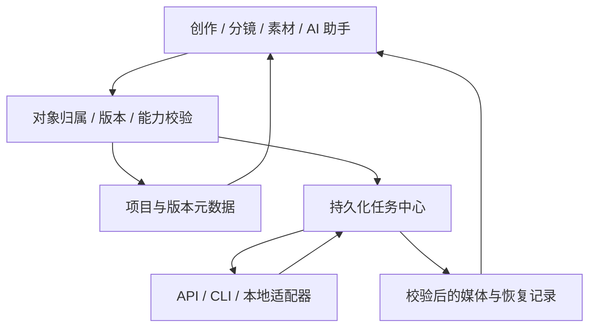

# AI 创作工作台技术方案

日期：2026-10-10。状态：方案整理版，面向个人使用；非新增接口冻结版，不代表功能已验收。

产品范围、交互规则与成功标准以[整体产品方案](./多模态创作工作台产品方案.md)为准；本文件维护实现决策与交付门槛；具体命令、数据契约及验证证据只在[多模态实现契约](./多模态实现契约.md)维护，避免多处复制。

方案结论：做一个“能利用自己已有资源的个人创作工作台”，以可编辑的创作对象组织流程，AI 是助手和受控执行者，不是必须一口气完成视频的黑盒。首版采用固定步骤、按步选择执行端，不增加通用节点引擎。

实施顺序是先接通已有资源与文字流程，再接通分镜图片和视频。视频一致性不留到最后补：从角色／场景资产、参考版本和镜头起止状态阶段就开始设计。每一步成果须可编辑、可保存和局部重做，不以一键生成整片为目标。

阅读顺序：本页看实现决策与交付门槛；产品方案看完整创作体验；实施契约看代码状态与验证证据。此次整理不修改功能代码、依赖、应用配置或项目数据，也不将历史检查结果作为本次新增验收。

| 技术决策 | 定版方向 |
| --- | --- |
| 复用底座 | 保留 Tauri 2、Rust、SQLite 和现有前端；按职责拆模块，不重建项目、不拆微服务 |
| 创作组织 | 文档、分镜和素材版本是结果载体；固定步骤可跳过，对话不是唯一数据源 |
| 资源抽象 | 能力与调用方式分离；API／CLI／本地服务通过受控适配器接入，不假设协议通用 |
| 执行端路由 | 项目步骤覆盖全局同能力默认；只有未配置时继承，明确失效的选择报错而不静默回退 |
| CLI 边界 | 校验安装、认证、协议与真实产物；受限输入和输出，不执行模型提供的任意 Shell |
| 知识与上下文 | 主动选择目录、只读来源、关键词检索保底、向量可选；实际发送范围可审阅 |
| 媒体一致性 | 固定正式参考版本、实际传递媒体、保存镜头起止状态；先审图再制片，完整播放后选用 |
| 数据可靠性 | SQLite 保存元数据，媒体存受控文件目录；恢复登记连接文件发布与数据库事务，完整包不含凭据 |
| 任务与费用 | 冻结输入后执行，持久化任务归属和可得远端标识；恢复查询／下载／收录不等于重新生成 |
| 平台与交付 | macOS Apple Silicon 先验收；文字、图片分阶段交付，视频按已有资源接入，Windows 和粗剪后置 |

## 1. 需求背景

在现有 `ai-creator-workbench` 内完善个人 AI 创作能力，利用已经拥有的 API、CLI、本地服务和知识资料。文字创作与剧本创作可以独立结束，图片和视频是可选延伸，不建设另一个一键视频平台。

复用现有桌面工程，不另起项目或重写前端框架。代码基线、工作区状态，以及各轮检查、构建、浏览器和原生验证分别记录在实施契约中，不由本方案代替验收报告。

现有项目与知识资料可复用。新增分镜、媒体、任务及 Codex 图片适配已存在于当前工作区源码，但不能据此宣称桌面预览、真实生成、重启恢复和完整备份已验收；详见实施契约。

## 2. 设计目标

1. 本地优先、空白启动，不生成示例项目、样例素材或虚假任务。
2. 同一创作流程按步骤选择已有 API／CLI／本地执行端，不绑定单一供应商。
3. AI 协助讨论、编辑和生成，结果可以直接编辑、比较、采纳或局部重做。
4. 角色、场景、镜头和媒体版本有明确关联；以实际参考输入、镜头状态和审阅提高一致性。
5. 任务先保存再执行；区分提交、查询、下载、收录和审核，避免未知状态导致重复生成。
6. 首先交付 macOS Apple Silicon；Windows 预留平台实现边界，不提前承诺发行支持。

首版不包含多人协作、社区、模型市场、通用节点编排器、无限画布、角色训练或完整专业剪辑器。粗剪、配音、音乐和口型按真实需要后置。

首版交付边界是“创作底座 + 分镜／图片闭环 + 一种实际已有视频资源的镜头制作闭环”，不是只交付聊天写作，也不是一次生成整集。P0／P1 可以独立交付，但不能因此宣布多模态首版完成；没有视频资源时明确保留 P2 未完成状态，不用占位预览替代。

使用时，每一步都遵循“确认输入 → 选择执行端 → 取得候选 → 编辑／采纳”。创作结果落在文档、镜头或素材版本中，聊天只是操作入口。用户可以只写剧本，也可以从已有图片或剧本直接进入制作，不必从灵感重新开始。

## 3. 实现方案

### 3.1 整体设计

#### 创作流程与工作区

提供文字、剧本、分镜制作三种流程预设，步骤可以跳过、回退或从已有资料开始。预设只创建空白结构，不预填正文。

| 创作路径 | 主要步骤 | 可以交付的结果 |
| --- | --- | --- |
| 文字创作 | 灵感／资料 → 简报 → 大纲 → 正文 → 修改 | 可编辑、可导出的文字内容 |
| 剧本创作 | 故事方向 → 人物／世界设定 → 分集／分场 → 剧本 → 校对 | 短剧／漫剧等剧集剧本，不要求继续生成视频 |
| 分镜与媒体 | 已有剧本／素材 → 拆镜 → 参考与状态校对 → 分镜图 → 可选视频 | 分镜清单、选用图片或镜头片段 |

项目内采用“创作／分镜／素材”视图，右侧是可收起的 AI 助手，任务中心通过抽屉查看。成片视图等粗剪真正可用后启用，不放置不可操作的假入口。

首版交互采用固定步骤导航，而不是通用节点画布：左侧选项目与内容，中间编辑当前成果，右侧调用 AI；当前步骤显示可用输入、执行端与输出位置。步骤导航已接入源码并完成部分浏览器验证；实际发送内容仍以助手／媒体计划预览为准，不能替代真实主路径验收。

总体创作路径：灵感／资料 → 简报 → 设定与大纲 → 正文／剧本 → 可选分镜 → 图片 → 可选视频 → 导出。

布局和对象关联借鉴 Flova 的可编辑文档、分镜与素材组织；视频操作借鉴 Flow 的参考素材及首尾帧迭代。这里是设计取舍，不机械分配两家产品的功能，也不把它们的网页订阅视为 API 授权。[Flova 工作区说明](https://flova.tv/en/docs/features/project-content-editing/)、[Flow 视频创作说明](https://support.google.com/flow/answer/16353334?co=GENIE.Platform%3DDesktop&hl=en)。

#### 资源连接与步骤路由

连接层负责认证、地址、受控可执行路径和协议；步骤层负责“这一步用哪个连接”。能力与接入方式分离：文本／图片／视频／图像理解／Embedding 是能力，API／CLI／本地服务是调用方式。

| 步骤 | 接入决策 | 能力门槛 |
| --- | --- | --- |
| 写作与剧本 | 复用现有文本 API、CLI 和本地模型 | 支持文本输出；流式与非流式分别处理 |
| AI 拆镜 | 复用文本执行端，增加结构化结果校验 | 输出有效镜头候选，不直接覆盖剧本 |
| 图片 | 按需接入图片 API；Codex CLI 纳入首批目标 | 分别验证生成、编辑、参考输入与真实文件交付 |
| 视频 | 首个适配器由实际已有资源决定 | 校验模式、时长、比例、参考组合与异步任务协议 |
| 知识检索 | 关键词检索为基础，Embedding 可选 | 无向量资源仍可检索与手动引用 |

能力声明包含合法输入组合、参数范围、输出类型及查询／取消／幂等能力。连接可达、已安装、已登录和真实生成成功分别呈现，不以配置了模型名称代替能力验证。

同协议可以复用适配器；不同认证、上传、异步提交或下载协议需要独立适配。任意 Base URL 不能自动兼容所有媒体服务。不静默换执行端，不混用 CLI 登录态与 API Key，不自动启用另一条计费路径。

资源只需在连接中心配置一次，再按步骤选择，不要求每次创作重新填写地址或命令。接入分为“登记连接 → 非生成检测 → 声明并校验能力 → 配置步骤路由”；真实生成单独验收。CLI 使用已支持的受控适配器，不提供任意脚本执行入口；新增 CLI 必须明确认证、输入、产物与取消协议。

默认资源与项目覆盖分开保存，按下表解析，不增加一个含义模糊的、跨能力通用的“项目默认”。

| 使用位置 | 解析顺序 |
| --- | --- |
| 文字助手及写作步骤 | 项目文字选择 → 全局文字默认 |
| AI 拆镜 | 项目拆镜选择 → 项目文字选择 → 全局文字默认 |
| 图片生成及图片批量计划 | 项目图片选择 → 全局图片默认 |
| 视频生成及视频批量计划 | 项目视频选择 → 全局视频默认 |
| 本地编辑、导入及导出 | 不需要 AI 执行端 |

只有未配置上一层时才继承。明确选择的连接被删除、能力不匹配，或执行时凭据不可用，应保留选择并报错，不把失败当作未配置而偷偷回退。全局默认可清空；同能力出现多个默认时要求重新选择，不从列表自动挑一个。图片／视频没有对应资源时允许导入或跳过，不使用文本连接代替。

修改全局默认只影响正在继承的步骤，不覆盖任何项目显式选择；修改当前项目文字只影响该项目，拆镜已有覆盖时也不受影响。切换或清空资源不提交生成、不传输创作内容。助手、步骤详情、单镜生成和批量计划共用同一解析结果，显示实际执行端及继承来源；计划确认后输入或资源改变须重新审阅。

同一项目的配置示例如下，仅说明目标用法，不表示资源已配置或调用通过：

| 步骤 | 可选已有资源 | 传给下一步的结果 |
| --- | --- | --- |
| 灵感、大纲、剧本 | 文本 API、现有文本 CLI 或本地模型 | 已采纳的可编辑文档及版本 |
| 拆镜 | 项目所选文本资源，或单独配置的文本 API／CLI | 经过校验与人工修改的镜头列表 |
| 角色参考、分镜图 | 经验证的 Codex CLI 图片能力，或已有图片 API | 正式参考版本及选用分镜图 |
| 镜头视频 | 已有、支持所需输入模式的视频 API／CLI | 校验收录的片段候选，完整审阅后选用 |
| 导出 | 本地导出，不需要 AI 执行端 | 正文、实际素材文件或完整项目包 |

步骤之间传递项目对象、确切参考版本及输入快照，不要求同一家供应商，也不将一个连接的登录或费用授权扩展到另一个连接。

#### Codex 图片接入

官方文档包含 CLI 图片生成与参考图使用方式；具体账户可用性仍需实测。[OpenAI Docs 图片生成说明](https://learn.chatgpt.com/docs/image-generation)。

当前实施方向采用受控 App Server stdio 适配，按安装版本生成的协议 Schema 校验事件；只接受匹配当前任务的原生图片完成事件及有效媒体文件，不将普通回复或任意输出路径视为图片产物。官方说明该接入具有实验性边界，因此定位为个人本地适配，不开放远程监听或承诺生产支持；记录兼容版本，升级 CLI 后重新核验，不兼容时停用并提示。[OpenAI Docs App Server](https://learn.chatgpt.com/docs/app-server)。

复用已有登录态必须保持显式授权与最小上下文，禁止读取凭据后转接未授权服务。生成目录和工具权限受限，产物校验后进入原项目候选。规划模型与实际图片模型分开记录，拿不到的信息明确未知。

#### 知识库与上下文

由用户选择 Obsidian Vault 或本地文件目录，只读导入；目录不硬编码，不默认访问整盘。Obsidian 笔记本身是本地 Markdown 文件，工作台自行维护可重建检索索引，不依赖读取某个插件的私有向量数据库。[Obsidian 数据存储说明](https://help.obsidian.md/data-storage)。

流程为提取文本 → 分段 → 记录来源 → 关键词检索／可选向量检索 → 选定片段进入上下文。来源变化后更新失效索引；首版沿用主动同步，不把后台监听作为前置依赖。

源笔记保留在 Obsidian；工作台保存来源关联和可重建索引，不把接入知识库等同于迁移、重组或改写 Vault。向量属于检索缓存，不是创作正文，也不是媒体参考文件。

首版默认使用本地关键词检索，可选择已有本地 Embedding 资源增强语义检索，不把向量服务作为使用前提。选择云端 Embedding 时，应在建索引前说明将发送哪些资料及可能产生的费用。建立索引和向创作模型发送检索片段是两次独立的数据发送，不把“只发送选中片段”误当作云端索引从未读取其他资料。

发送前展示实际文档、选区、设定、知识片段及截断情况，允许逐项移除；`@` 引用明确绑定当前项目对象。冻结的发送快照不受后续编辑影响。文字接口只能接收素材说明时必须明确标注，没有传媒体字节就不能声称模型已看到图片。

向量用于检索相关设定，不负责锁定人物视觉身份；视觉一致性必须通过媒体执行端实际接收参考图实现。

#### 一致性设计

采用“正式参考素材 + 固定版本 + 镜头状态 + 人工审核”，不依赖一句“保持一致”或固定 seed。

- 角色／服装、场景／道具和风格分别建立参考资产；镜头绑定确切版本，不自动跟随最新候选。
- 每个镜头记录画面、动作、运镜、进入／结束状态和切镜／连续动作关系。
- 提交时固定输入快照，发送实际媒体字节或执行端可读取的授权引用；不支持的组合在提交前拦截，不静默丢弃参考。
- 默认先审分镜图，再以选定画面制作视频；视频完成后检查关键帧并完整播放，只有用户明确选用才算审阅通过。
- 连续动作优先使用执行端原生续接；末帧作为下一段起始图只是较弱替代。切换机位则重新构图并继承必要状态，不机械复用末帧。
- 参考更新或剧本变更只标记影响范围，不自动重做已有素材。发生漂移时回到正式参考，不继续累积错误。

工作台管理约束与追溯，底层模型决定遵循程度；首尾帧也不保证中间过程稳定。图像理解可以提示疑点，但不代替人工审阅，也不自动触发无限重生成。

以下仅为方案中的衔接示意，不创建应用示例数据。三个镜头都绑定同一组已确认的角色、服装与房间参考版本；进入执行端的是对应实际文件，而不只是名称。

| 镜头关系 | 需要保持的状态 | 制作方式 |
| --- | --- | --- |
| 镜头 1：角色走向桌边 | 右手持杯，从门口走到桌前；杯仍在右手 | 审核分镜图后制作视频，核对结束状态 |
| 镜头 2：同机位连续放杯 | 从桌前持杯开始，结束时杯在桌面、手已离开 | 支持时用原生续接；否则审核上一段末帧再作起始图，并提示运动连续性较弱 |
| 镜头 3：切近景看角色反应 | 杯仍在同一桌面位置，服装、视线与光线衔接 | 按正式参考重新构图制作分镜图，不机械复用上一段末帧作为新机位 |

每次审核分别回答“身份与服装是否一致”“空间与道具是否正确”“动作与机位是否衔接”。发现漂移只重做受影响镜头；如果错误来自正式参考本身，则先修正参考并显示影响范围，再由用户选择重做对象。

#### AI 助手与受控执行

讨论只返回建议；编辑返回可审阅候选；生成创建明确目标的任务。普通发送不增加确认弹窗，发送后清空输入，失败可重试。批量生成先展示镜头、参考版本、执行端、数量和可得费用，一次确认范围。

直接写作复用现有执行端。涉及项目修改时，由一个规划模型提出结构化操作，应用负责对象归属、基础版本、字段和能力校验；不执行模型任意生成的 Shell。

批量执行采用“预览计划 → 一次确认 → 持久化队列”：所有确认输入必须在首次执行前保存，限定数量、并发和依赖深度；输入、参考或资源改变须重新审阅。停止批次后不启动剩余任务，已完成素材保留。图片尚未审核时不自动进入默认视频步骤。这里定义目标行为，当前源码和验收状态以实施契约为准，不将界面预览等同于原生执行已验收。

#### 模块与数据边界

保留 Tauri 2 + Rust + SQLite 与现有前端，不把此次升级和框架重写绑定。采用单应用、按职责拆模块，不拆微服务。

项目快照保存文档、流程和镜头关联；媒体与任务使用专用 SQLite 表，媒体字节存应用管理目录，内部文件标识与相对路径关联，不塞入项目 JSON。

文件与数据库没有跨介质原子事务：先保存恢复登记，再原子发布已验证文件，最后在 SQLite 事务中登记媒体并移除恢复记录；启动后核对中断状态。完整项目包包含真实文件、元数据和损坏校验，导入重映射标识并恢复为独立项目，不含凭据。

### 3.2 总体流程

以制作一集短剧／漫剧为例，目标使用流程如下；这只是流程示意，不向应用植入示例内容，也不代表这些能力已经验收。

| 环节 | 用户操作 | AI／工作台职责 | 保留下来的成果 |
| --- | --- | --- | --- |
| 准备 | 选择已有文字、图片或视频资源，按需关联知识资料 | 检测连接与能力，不自动生成；缺少媒体资源仍可写作 | 项目配置与明确的资料引用 |
| 写剧本 | 输入方向，逐步修改大纲、设定和分场 | 使用所选文字 API／CLI 提出候选，用户可编辑和采纳 | 可独立导出的剧本及版本 |
| 拆镜与准备参考 | 选择剧本范围、确认角色和场景参考 | 提出有序镜头，校验来源、固定参考版本和起止状态 | 可修改的镜头列表与引用关系 |
| 制作画面 | 单镜生成或确认一个批量范围 | 所选图片执行端接收实际参考，校验文件并收录候选 | 已审核的分镜图及未选候选 |
| 制作视频 | 对已选画面指定动作与运镜，生成后完整播放 | 按资源支持的图生视频／首尾帧／续接模式执行；失败仅恢复对应阶段 | 原镜头下的片段候选与人工选用记录 |
| 导出与复用 | 导出文字、素材或完整项目包 | 保存真实文件和关联；应用内粗剪尚非前置条件 | 可继续创作或交给外部剪辑软件的成果 |

用户可以停在任意已有成果处；更换某一步执行端不要求重做整个项目。上游修改只提示下游可能过期，不清空素材、不自动追加生成。

单次生成：校验目标与能力 → 冻结输入 → 保存任务 → 提交 → 保存远端标识／原生产物记录 → 查询或接收结果 → 下载与文件校验 → 登记候选 → 人工选用。

当前已有命令的实现边界如下；应用句柄等内部参数省略后的展示不是新接口定义，完整参数以实施契约为准。

| 入口 | 核心步骤与事务边界 |
| --- | --- |
| `media_submit(app, request: Request) -> Result<Job, String>` | 校验并保存任务后后台执行；远端调用不置于数据库事务内 |
| `media_submit_batch(app, batch_id: String, requests: Vec<Request>) -> Result<Vec<Job>, String>` | 整批预检并在同一事务保存全部输入后再调度；同一批次标识不重复提交，不因局部失败追加生成 |
| `media_cancel_batch(app, project_id: String, batch_id: String) -> Result<Vec<Job>, String>` | 校验批次归属，停止未开始任务和本地等待；保留已完成结果，明确远端可能继续计费 |
| `media_cancel(app, project_id: String, job_id: String) -> Result<Job, String>` | 检查项目归属，停止本地等待与后续步骤；明确远端取消能力 |
| `media_resume(app, project_id: String, job_id: String, api_key: Option<String>) -> Result<Job, String>` | 恢复查询、下载或本地收录，不隐式重新生成 |
| `library_write` 与完整包导入 | 文件预验证和暂存后，项目快照与媒体登记在同一 SQLite 事务提交 |

关键失败分支：提交超时且无法确认接受结果时进入待确认状态；有远端标识则恢复查询；只有下载失败时仅重新下载；登记失败则恢复收录。没有幂等或查询能力时不得自动重新提交。错误显示可执行的恢复建议，已有文稿与素材保留。

结果始终回到原项目和原目标，切换项目不改变归属。编辑冲突保留双方版本，不覆盖用户新输入。密钥仅在调用所需的内存／系统凭据存储内使用，不进入持久化任务、日志或备份。

### 3.3 监控报警

本项目是个人本地桌面应用，无生产业务服务与集中运营数据源，不接入企业发布监控、SLS 或 DMS；本轮无自动上线监控项。

监控归属：`monitor_needed: false`，验收类型：`manual`。不创建企业监控计划或执行外部数据查询。

采用本地任务状态、保存错误、恢复问题与媒体工具缺失提示；诊断记录不得包含密钥或完整私有上下文。云端执行可能消耗额度，本地存储不等于离线生成。

### 3.4 数据验证

沿用既有项目快照并扩展媒体专用存储；步骤导航与按需空白正文不引入新的项目 schema。验收须核对项目／镜头／素材归属、固定版本引用、真实文件完整性和任务恢复，不仅检查界面成功提示。

关键可重复验收场景：

- 文字闭环：空白项目与已有文本资源 → 创作、修改、采纳和导出 → 原文与引用可追溯。
- 图片闭环：已有剧本与正式参考 → 拆出并修改至少 6 个镜头，取得真实图片 → 文件自动收录，重启后选用关系保持。
- 视频闭环：已审核分镜图与实际视频资源 → 制作至少 3 个片段 → 完整播放并人工核对角色、服装、场景和动作衔接。
- 恢复边界：提交未知、下载失败、项目切换或取消 → 对应阶段恢复 → 不重复创建远端生成，已有素材不丢。
- 完整备份：含媒体项目导出后恢复为独立项目 → 文件校验通过、引用可用 → 原项目保留，凭据不入包。

静态检查、已有回归、前端构建、原生桌面操作、真实服务调用和打包分别记录。既有测试通过不能代替新增媒体端到端验收。

## 4. 相关改动

下表为实现影响面，不表示本次修改了这些源码。新增命令及数据变更在编码前继续由实施契约冻结，本文件不复制字段定义或新增 DDL。

| 涉及服务 | 文件／模块 | 改动类型 | 涉及字段方法／职责 | 说明 |
| --- | --- | --- | --- | --- |
| 前端 | `src/app.js`、`index.html`、`src/styles.css` | 整合／待验收 | 项目视图、上下文预览、助手与计划交互 | 保留文字路径，避免多余确认 |
| 前端 | `src/creation-workflow.js` | 复用／扩展 | `prepareGeneration` | 有界上下文与不可变发送输入 |
| 前端 | `src/project-operations.js`、`src/project-plan-ui.js` | 受控操作／待完整验收 | 目标清单、计划校验、媒体选用、准备批量计划及原子项目保存 | 先审阅本地改动，再核对真实生成输入，不执行任意命令；完整工具范围由实施契约维护 |
| 前端 | `src/workflow-navigation.js`、`src/app.js`、`src/creation-workflow.js` | 步骤导航／待真实主路径验收 | 路径定位、跳步返回、空白 `draft`、上游输入及导出 | 不把步骤序号当作完成率，不自动建集或发起生成 |
| 前端 | `src/storyboard.js`、`src/media-workbench.js` | 新增源码／继续完善 | 分镜、引用、媒体视图与候选 | 固定版本、局部重做及审核 |
| 前端 | `src/project-store.js` | 兼容扩展 | 快照保存与项目包入口 | 保留旧项目及文字备份 |
| Rust | `media_jobs.rs`、`runtime.rs` | 任务整合／待验收 | 单项与批量提交、取消、恢复、受控进程 | 确认输入先落盘，不重试未知提交 |
| Rust | `media_codex.rs`、`media_video.rs` | 协议适配／待实测 | 原生图片事件、视频提交与查询 | 不把协议握手当生成验收 |
| Rust | `media.rs`、`media_integrity.rs`、`media_package.rs`、`storage.rs` | 持久化扩展／待验收 | 媒体登记、文件校验与备份恢复 | 真实文件与恢复记录共同核对 |
| Rust | `lib.rs` | 集成 | 状态、命令、受控媒体协议、退出清理 | 原生协议与预览权限需单独验证 |

数据库沿用项目快照并复用当前媒体专用表；本轮不修改结构。配置依赖包括受控媒体预览 CSP 放行、CLI 兼容版本及媒体工具的发行方式，未获准或未验证的变更不能当作已交付。

## 5. 风险评估

| 风险 | 处理决策 |
| --- | --- |
| CLI 安装或原生事件存在，但实际账号不可生成 | 分开验证登录、工具、参考输入和真实产物；不自动转付费 API |
| CLI 协议升级或实验性能力变化 | 固定并记录已验版本，按本机 Schema 核验；不兼容时明确停用，不用文字回复冒充图片 |
| 视频资源尚未明确 | 先确认已有资源协议，只适配实际需要的模式；不默认 Google 或其他供应商 |
| 相同参考仍发生视觉漂移 | 固定参考和镜头状态，保留候选，人工比较并局部重做；不承诺绝对一致 |
| 超时、取消和重启引发重复费用 | 保存输入与远端标识，未知提交不自动重试；远端不可取消时明确提示 |
| 浏览器可展示但原生 WebView 无法预览 | 验证受控协议及 CSP，不能用浏览器结果代替桌面验收 |
| 本机有媒体工具但发行包没有 | 明确随包／外部依赖、平台架构和许可证；缺失时提供清楚提示 |
| 备份仅有元数据或恢复后引用失效 | 完整包包含真实字节并校验，验证独立项目往返与中断恢复 |

## 6. 排期

以里程碑而非未核实工期推进。每阶段可独立交付，具体日期取决于实际资源及原生验收结果。

先跑通一条最小真实路径，再扩展适配器：已有文字资源完成一份内容 → 一个实际图片资源完成分镜 → 一个实际视频资源完成片段。不能用增加供应商数量、占位页面或模拟成功代替这条路径；视频阶段无需等待应用内剪辑器。真实生成验收须事先明确执行端、输入和数量，额度未知如实说明，不把方案确认当成无限生成授权。

首轮联调只需当前步骤的一种真实资源：文字可选 API 或 CLI，图片可选 Codex CLI 或图片 API，视频按用户已有协议接入。无需三者来自同一供应商，也无需为技术方案额外采购；但接口未知时不能先把某家适配器写成默认可用。

| 阶段 | 交付门槛 |
| --- | --- |
| P0 资源与文字 | 完成真实文字闭环、步骤执行端选择、上下文审阅及必要结构化操作 |
| P1 分镜与图片 | 完成至少 6 镜头编辑、真实图片收录、原生预览、重启与完整媒体备份 |
| P2 视频与一致性（有资源时） | 实际视频资源可用，完成至少 3 片段及一致性、取消和恢复验证；缺少视频资源不阻塞 P0／P1 独立交付 |
| P3 可选粗剪 | 确有需要再做排序、裁剪、音轨／字幕与本地渲染；此前导出素材供外部剪辑 |

## 7. 上线方案

在现有应用内迭代，不重建项目，不把方案文档、源码检查或浏览器验证当作完整交付。升级前保留可恢复副本；完成约定验收后再提交并打包。含新媒体结构的数据不能未经转换直接交给旧版。

上线前检查：旧项目可读、空白启动无示例、无凭据入包、原生预览可用、任务归属与恢复正确、媒体工具依赖明确、完整备份可恢复、安装包平台与签名状态如实说明。

## 8. 其他相关信息

- P0 文字与 P1 分镜／图片核心主路径已于 2026-10-12 在 macOS 隔离桌面环境验收，包含现有 Codex CLI 六镜头、真实参考图片生成、原生预览、选用后重启与完整包往返；验证历史与未覆盖项统一查看实施契约。这不代表正式发布或全部异常分支通过。
- 尚待核验：其他账号／CLI 版本与登录刷新、复杂参考和真实批量取消、首个实际视频资源及至少三片段的一致性；Windows 与 Apple 公证未验收。视频当前按用户选择先完成通用接入框架。
- 资源接入时只需明确名称、调用协议／文档、认证方式和拟用步骤；密钥在本机连接中心配置，不在聊天、方案或项目包中收集。优先确认当前阶段需要的一种资源，不要求先列齐所有供应商。
- 最先确认已有视频资源的实际协议与图生视频能力，再决定首个视频适配器；首尾帧、参考图和续接按合法模式开放，不因界面参考 Flow 就默认接入 Google 服务。
- 方案整理不构成真实生成授权。联调前另行明确执行端、输入、最大生成数量及可接受费用；没有额度或必要权限时保留未验收状态，不自动采购或更换计费路径。
- 方案整理本身不授权生成；后续已有单独授权的真实调用及结果在实施契约记录，不将方案阶段的“未发起生成”当作当前实施状态。
